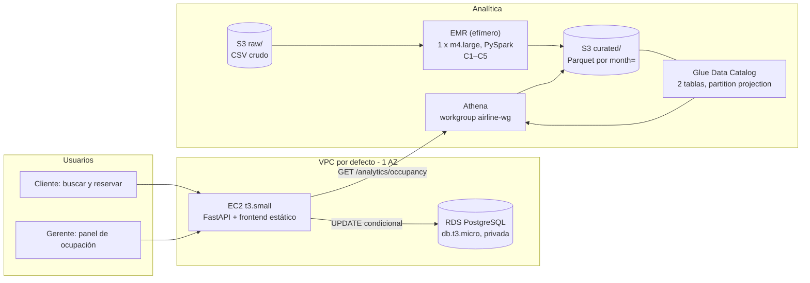

# Parcial 2 — Sección 5: decisiones de arquitectura (borrador)

Equipo con semilla 963. Cada decisión cita un requisito (R1–R12) y un pilar del AWS Well-Architected.
Borrador para la entrega parcial; se completa con evidencia al terminar.

## Diagrama de arquitectura

La ruta de reservas (EC2 → RDS) y la ruta analítica (EC2 → Athena → S3) no comparten base de datos ni cómputo pesado: EMR corre fuera de la EC2 y Athena es serverless.

## Decisiones

**1. Hosting.** Backend y frontend corren en **una EC2 t3.small** (un solo proceso FastAPI que sirve también el frontend estático) y la base transaccional en **RDS PostgreSQL db.t3.micro, 1 AZ, no pública**. Es lo más barato que cumple R1 y R2: PostgreSQL ofrece el bloqueo de fila que necesita la anti-sobreventa; una instancia pequeña alcanza para p95 ≤ 1 s con 20 clientes porque la búsqueda es una consulta indexada por (ruta, fecha). Una opción más gestionada (ECS/Fargate + ALB, Aurora) agrega ~US$16/mes sólo de balanceador (R11) sin mejorar ningún requisito; una menos gestionada (Postgres dentro de la EC2) ahorra ~US$14/mes pero pierde respaldos y aislamiento de la base. *R1, R2, R11 · Optimización de costos, Confiabilidad.*

**2. Por qué EMR.** El historial crudo (2 M de filas, sucio) debe limpiarse con reglas fijas C1–C5 y agregarse por ruta y mes. EMR/PySpark lo hace de forma distribuida y repetible, y escribe Parquet particionado que Athena puede consultar barato. Athena sola podría escribir (CTAS) pero no ofrece el mismo control de transformaciones ni escala si el volumen crece ×10; un Glue Job sería equivalente, pero el curso exige EMR. Se eligió **cluster EMR clásico con 1 × m4.large** (la única clase disponible en el Lab; Serverless no aplica) lanzado con `--auto-terminate` por `run_emr.sh`: el cluster se apaga solo al terminar el step y nunca queda vivo (R10), ni forma parte del stack de CloudFormation. Una corrida de ~0,5 h consume ~2 horas normalizadas (tope: 150). *R4, R10 · Optimización de costos, Sostenibilidad, Excelencia operativa.*

**3. Organización de los datos.** Parquet (columnar y comprimido) y partición por mes. Consultar un mes sólo lee su prefijo `month=YYYY-MM/`, ~1/24 de los datos; sin particiones y con CSV, la misma consulta escanearía todo el historial (decenas de veces más bytes, R6 exige ≤ 2× una partición). Las particiones se resuelven con **partition projection** (2023-01…2024-12), sin crawlers ni `MSCK REPAIR`. La tabla de métricas (216 filas) es un solo archivo pequeño. *R5, R6 · Optimización de costos, Eficiencia de rendimiento, Sostenibilidad.*

**4. Cómo obtiene el panel sus números.** `GET /analytics/occupancy` ejecuta una consulta Athena sobre `route_month_metrics` (pocas filas, pocos KB escaneados). Latencia: típicamente 1–3 s, dentro del límite de 10 s (R7). Costo por consulta: fracciones de centavo (US$5/TB). Frescura: los datos son los de la última corrida de EMR (carga mensual), suficiente para análisis gerencial. No se usa caché: el volumen es bajo y el contrato exige consultar Athena en la primera petición por par; un caché tendría sentido sólo con miles de consultas/día. *R7, R9 · Eficiencia de rendimiento, Optimización de costos, Seguridad (parámetros validados con lista blanca).*

**5. Separación de cargas.** Reservas y analítica no comparten recursos: las reservas viven en RDS; el análisis vive en S3 + Athena (serverless) y el procesamiento pesado en EMR, fuera de la EC2. Analizar el historial nunca consume conexiones ni CPU de la base de reservas. Dentro de la API, el pool de conexiones (20 + 40) está dimensionado para 50 reservas simultáneas y la anti-sobreventa es un único `UPDATE` atómico. *R1, R2 · Confiabilidad, Eficiencia de rendimiento.*

## Tabla de justificación de servicios

| Servicio | Alternativa considerada | Requisito | Pilar(es) |
|---|---|---|---|
| EC2 t3.small | Fargate + ALB; Lambda | R1, R2, R8, R11 | Optimización de costos, Excelencia operativa |
| RDS PostgreSQL db.t3.micro, 1 AZ | Postgres en la EC2; Aurora; DynamoDB | R2, R3, R11 | Confiabilidad, Seguridad (cifrado, no pública) |
| S3 | EBS / HDFS en el cluster | R4, R5 | Optimización de costos, Sostenibilidad |
| EMR 1 × m4.large efímero | Glue Job; Athena CTAS | R4, R10 | Optimización de costos, Sostenibilidad |
| Glue Data Catalog (sin crawlers) | Crawlers; tablas Hive propias | R5 | Excelencia operativa, Optimización de costos |
| Athena (workgroup con tope de 1 GB/consulta) | RDS analítica; Redshift | R6, R7 | Optimización de costos, Eficiencia de rendimiento |

Servicios facturables: EC2, RDS, S3, EMR, Glue, Athena (6 de un máximo de 8). Sin NAT Gateway, sin balanceador, sin Multi-AZ.

## Proyección de costos

Detalle en `cost_projection.yaml` (≈ US$31,9/mes: EC2 15,18 · RDS 12,41 + 2,30 · EBS 1,60 · S3/Athena/EMR < 0,5). Supuestos: ~50 usuarios internos, ~2.000 búsquedas y ~200 reservas al día, ~100 consultas Athena al día, 1 corrida mensual de EMR.

**¿Y si el volumen de datos o de consultas se multiplica por 10?** El costo no se multiplica por 10: las partes dominantes (EC2 y RDS, ~90 % del total) son fijas y no crecen con el historial. Con datos ×10, S3 sube de US$0,10 a ~US$1 y EMR de 0,2 a ~US$1–2 (más nodos o más tiempo, una vez al mes); con consultas ×10, Athena sube de 0,10 a ~US$1 porque cada consulta sigue leyendo sólo una partición. El total pasaría de ~US$32 a ~US$36 (≈ +12 %). Esto se apoya en Parquet + partición (menos bytes escaneados, *Optimización de costos*) y en no mantener cómputo analítico encendido (*Sostenibilidad*: se usa energía sólo mientras corre el job).
