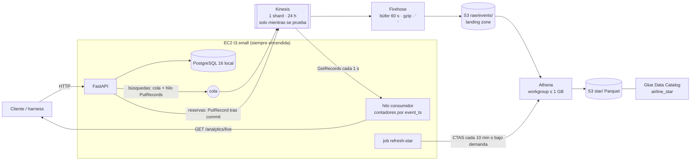
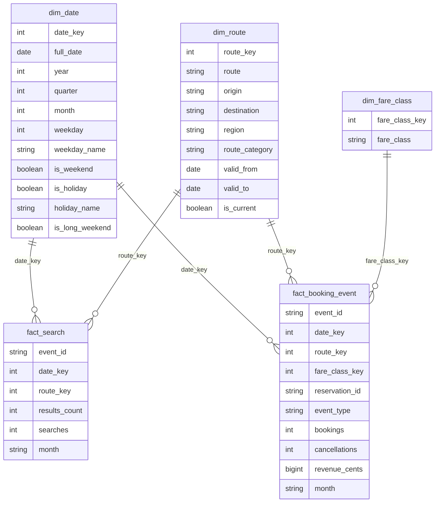

# Parcial 3 — Sección 5: decisiones y justificación (borrador de entrega parcial)

Equipo: semilla 963. Sistema de reservas de RegionalAir: eventos en Kinesis, vista en vivo y modelo estrella en Athena.

Pilares Well-Architected abreviados: **EO** Excelencia operativa · **SEG** Seguridad · **CONF** Confiabilidad · **EF** Eficiencia de rendimiento · **COST** Optimización de costos · **SOS** Sostenibilidad.

---

## 5.0 Arquitectura

Hay dos caminos con latencias distintas. El **rápido** (segundos) va de Kinesis al consumidor y de ahí a `/analytics/live`. El **analítico** (minutos) va de Kinesis a Firehose, de ahí a S3, luego al CTAS de Athena y termina en la estrella. Solo existen todo el tiempo la EC2, el bucket, la base Glue y el workgroup. El stream y Firehose se crean con `crear_stream.sh` y se borran con `borrar_stream.sh`.

---

## 5.1 Qué entra al stream y qué no

**Qué se publica.** Se publican tres tipos de evento: `search_performed`, `reservation_created` y `reservation_cancelled`. Siguen el contrato A.1 y nunca llevan el nombre del pasajero. La clave de partición es `session_id` para las búsquedas y `flight_id` para las reservas (**R1**, **SEG**: sin datos personales).

**Por qué las búsquedas encajan bien en Kinesis.** Son muchas, cada una vale poco y solo interesan agregadas. Perder alguna no cambia ninguna decisión, pero hacer esperar al usuario sí hace daño. Por eso se publican **de forma asíncrona**: la petición solo encola el evento y un hilo lo envía en lotes de hasta 500 con `PutRecords`. Si un lote falla a medias, se reintentan solo los registros fallidos, así que no se duplican los que ya entraron. Con la cola llena, la búsqueda se descarta. En la ráfaga de R2 (200 búsquedas, 50 a la vez) el p95 local fue de 0,045 s y llegaron 200 eventos de 200 (**R2**, **EF**, **CONF**).

**Por qué las reservas son delicadas.** Una reserva es una transacción de negocio: perderla descuadra los ingresos. Se publica **después del commit**, con `PutRecord` síncrono y reintentos. Así nunca se publica una reserva que no quedó guardada. Queda un hueco: si el proceso muere entre el commit y el `PutRecord`, el evento se pierde (**R1**, **CONF**).

**Cómo se cerraría ese hueco en producción (*transactional outbox*, solo se describe).** En la misma transacción que inserta la reserva se inserta una fila en una tabla `outbox(event_id, payload, published_at NULL)`. Un publicador aparte lee las filas pendientes, las envía a Kinesis y marca `published_at`. Si cae, vuelve a enviar las que no quedaron marcadas, con el mismo `event_id`. Eso da entrega "al menos una vez", y los duplicados se eliminan aguas abajo por `event_id` (ver 5.6). Una alternativa equivalente es CDC sobre el WAL de PostgreSQL, por ejemplo con Debezium.

**Qué no entra al stream.** No entran el nombre del pasajero, la consulta de una reserva (`GET /reservations/{id}`), que no es un hecho de negocio, ni la creación de vuelos. Tampoco se publica el estado completo de la base, solo hechos que ocurrieron.

## 5.2 Dos caminos

**Por qué la vista en vivo lee el stream y no Athena.** R3 pide reflejar un evento en menos de 10 s. Athena lee la landing zone, que tiene el retraso del búfer de Firehose (unos 60 s), tarda segundos por consulta y cobra por cada una con un mínimo de 10 MB. Si el panel consultara cada 3 s, serían 28.800 consultas al día. El consumidor es un hilo dentro de la misma API: lee el único shard cada 1 s con `GetRecords` (un consumidor estándar, sin *enhanced fan-out*, **R11**). Guarda en memoria los eventos de la última hora, indexados por `event_id`, y cuenta por **`event_ts`**. Al arrancar lee desde hace una hora (`AT_TIMESTAMP`), así un reinicio no deja la vista en cero. Su costo es US$0 adicional (**R3**, **EF**, **COST**).

**Por qué la estrella se refresca cada pocos minutos y no por evento.** Una estrella en Parquet sobre S3 está hecha para lecturas analíticas grandes, no para escrituras pequeñas. Actualizarla por evento rompería varias cosas:
1. Cada evento crearía un archivo Parquet minúsculo. Con 20 mil eventos serían 20 mil archivos, y Athena se vuelve lento y caro al listarlos y abrirlos (el problema de los archivos pequeños).
2. Cada `INSERT` en Athena factura al menos 10 MB y tarda segundos: 20 mil inserts costarían unos US$1 y horas de cola.
3. La deduplicación y los eventos tardíos exigirían reescribir particiones ya publicadas en cada evento.
4. Las particiones nuevas tendrían que registrarse en Glue por cada evento.

Con micro-lotes (temporizador de 10 min, más `POST /admin/refresh-star` bajo demanda) cada refresco escribe pocos archivos grandes y resuelve en un solo paso los duplicados y los eventos tardíos (**R8**, **EF**, **COST**, **SOS**).

## 5.3 Landing zone: de Kinesis a S3

Se eligió **Kinesis Data Firehose** con el stream como fuente: búfer de 60 s o 5 MB, compresión GZIP, prefijo `raw/events/AAAA/MM/DD/HH/` y el procesador **AppendDelimiterToRecord**, que agrega `\n` a cada registro.
- **Por qué Firehose y no un consumidor propio.** Es un servicio gestionado: reintenta, guarda su avance en el shard y separa los errores en `raw/errors/`, sin código que mantener. Un consumidor propio que escriba en S3 costaría US$0, pero si la EC2 se cae dejaría de llegar la landing zone, que justamente es la copia durable. Con Firehose, el camino analítico no depende de la API (**R4**, **CONF**, **EO**).
- **Por qué el delimitador.** El replay del harness escribe JSON compacto sin salto de línea. Sin `\n`, Firehose concatena los eventos (`}{`) y la SerDe JSON de Athena, que lee un objeto por línea, no puede leerlos.
- **Latencia.** Entre 60 y 90 s desde que el evento entra al stream hasta que el objeto aparece en S3, muy por debajo del límite de 5 min de R4.
- **Costo.** US$0,029 por GB ingerido, con cada registro redondeado a 5 KB: unos US$0,05 al mes (ver 5.8). Firehose también lee el shard, pero cuenta como consumidor estándar y no suma consumidores EFO (**R11**).

## 5.4 Diseño del modelo estrella

### Granos
| Tabla de hechos | Grano | Medidas |
|---|---|---|
| `fact_search` | una fila por evento de búsqueda distinto (`event_id`) | `searches` (=1), `results_count`, `days_to_travel` |
| `fact_booking_event` | una fila por evento de reserva distinto: creación **o** cancelación | `bookings` (1/0), `cancellations` (0/1), `revenue_cents` (+precio / −precio) |

La cancelación es una fila propia con ingreso negativo, no una actualización de la reserva original. Así el hecho es inmutable (*append-only*), igual que la landing zone, y el ingreso neto sale de un simple `SUM(revenue_cents)`. Además, cada ingreso y cada reverso queda en su fecha real.

### Dimensiones
| Dimensión | Grano | Columnas del contrato | Atributos agregados (y por qué) |
|---|---|---|---|
| `dim_date` (conformada) | un día, de 2023-01-01 a 2027-12-31 | date_key, full_date, year, month, quarter, weekday, weekday_name, is_weekend, is_holiday, holiday_name, is_long_weekend | `month_name`, `year_month` (etiquetas de reportes y unión con la partición `month`), `day_of_month`, `is_business_day` (comparar días hábiles con festivos y fines de semana) |
| `dim_route` (conformada, SCD 2) | una versión de una ruta | route_key, route, origin, destination, region, route_category, valid_from, valid_to, is_current | `version` (número de versión, para auditar); miembro `route_key = 0` "UNKNOWN" para rutas que no están en la referencia |
| `dim_fare_class` | una clase tarifaria | fare_class_key, fare_class | `fare_class_name`, `cabin_rank` (ordenar ECONOMY < BUSINESS); miembro 0 "UNKNOWN" |

Atributos degenerados en los hechos (no son personales): `session_id`, `travel_date` y `event_ts` en `fact_search`; `reservation_id`, `flight_id`, `flight_date` y `event_ts` en `fact_booking_event`. Las dos tablas de hechos se **particionan por `month`** (`YYYY-MM` de `event_ts`) para que un filtro por mes lea solo una carpeta (**R10**).

`dim_date` y `dim_route` son **conformadas**: las comparten los dos hechos con las mismas claves. Eso es lo que permite Q6 y Q7, que comparan búsquedas con reservas.

### Matriz bus

| Pregunta | Hecho(s) | Medida | dim_date | dim_route | dim_fare_class |
|---|---|---|---|---|---|
| Q1 ingreso neto por mes y clase | fact_booking_event | SUM(revenue_cents) | ✔ year, month | | ✔ fare_class |
| Q2 reservas, cancelaciones y tasa por ruta | fact_booking_event | SUM(bookings), SUM(cancellations) | | ✔ route | |
| Q3 reservas por día de la semana | fact_booking_event | SUM(bookings) | ✔ weekday_name | | |
| Q4 top 10 rutas por ingreso neto | fact_booking_event | SUM(revenue_cents) | | ✔ route | |
| Q5 ingreso por mes y categoría vigente | fact_booking_event | SUM(revenue_cents) | ✔ year, month | ✔ route_category (versión SCD2) | |
| Q6 conversión por ruta | fact_search + fact_booking_event | COUNT / SUM(searches), SUM(bookings) | | ✔ route (conformada) | |
| Q7 festivos frente a otros días | fact_search + fact_booking_event | SUM(searches), SUM(bookings) | ✔ is_holiday (conformada) | | |
| Q8 reservas en puentes | fact_booking_event | SUM(bookings) | ✔ is_long_weekend | | |

**Regla del puente** (igual a la del enunciado). Un lunes o viernes pertenece a un puente si es festivo. Un sábado pertenece si el viernes anterior o el lunes siguiente es festivo. Un domingo pertenece si el viernes anterior o el lunes siguiente es festivo. En SQL se resuelve con cinco *joins* de `dim_date` contra los festivos, desplazados entre −2 y +2 días.

## 5.5 ETL: el mejor proceso para esta carga

**Qué hace la transformación.** Deduplica por `event_id`, asigna la fecha por `event_ts`, resuelve las claves sustitutas y la versión de ruta vigente, escribe Parquet y registra particiones. Con la semilla 963, el replay son 20.509 registros (unos 5 MB en JSON y menos de 1 MB en gzip).

| Criterio | **Athena CTAS programado** (elegido) | Lambda + DuckDB | Glue job (Spark) |
|---|---|---|---|
| Costo por corrida | 8 consultas × 10 MB mínimo = 80 MB → **US$0,0004** | ~60 s × 2 GB = 120 GB-s → US$0,002, más S3 GET | 2 DPU × ~2 min (con arranque) × 0,44 → **US$0,03** |
| Costo al mes (360 corridas) | **~US$0,15** | ~US$0,72 | ~US$10,60 |
| Arranque frente al límite de 15 min | sin arranque; la corrida completa tarda 1–2 min | arranque en frío de 1–3 s; tope duro de 15 min por invocación | ~1 min de arranque del clúster |
| Crecimiento del volumen | sin servidores; el costo crece en proporción a lo escaneado | límite de 10 GB de memoria y 15 min: no escala sin partir el trabajo | escala horizontalmente (más DPU) |
| Operación | solo SQL (`star_sql.py`), sin paquetes ni roles nuevos; Glue registra las particiones solo | empaquetar DuckDB en una capa, registrar particiones a mano | script Spark, configuración del job y de los DPU |
| Idempotencia | reconstrucción completa: DROP y CTAS a un prefijo nuevo; repetir el lote da las mismas filas | hay que programarla (sobrescribir) | hay que programarla (modo *overwrite*) |

**Decisión: Athena CTAS, lanzado por el backend.** Es la opción más barata (unas 70 veces menos que Glue), no tiene arranque y su idempotencia es estructural: nunca hay `INSERT` sobre datos anteriores. Cada corrida escribe en `star/<tabla>/<run_id>/` y después borra el prefijo viejo. El SQL se verificó en local con DuckDB (traducido con sqlglot) contra el oráculo del harness: Q1–Q8, deduplicación, fecha por evento y SCD2 cuadran exactamente (**R7**, **R8**, **COST**, **EO**).

**Cuándo cambiarla.** La reconstrucción completa escanea toda la historia en cada corrida. Con 66 mil eventos al mes, un año ocupa unos 20 MB en gzip, lo que sigue siendo trivial. Si el volumen llegara a millones de eventos diarios (decenas de GB por reconstrucción, o corridas cerca de los 15 min), se pasaría a un proceso **incremental**: procesar solo las carpetas horarias nuevas de Firehose con `INSERT INTO` por partición y deduplicar contra una ventana de días (o usar tablas Iceberg con `MERGE`). Si la transformación se volviera pesada (*joins* grandes, ML), se movería a Glue o EMR Serverless.

## 5.6 Dimensión de cambio lento (SCD)

**Por qué tipo 2 para la categoría de la ruta.** Con la semilla 963 cambian de categoría el 2025-02-01 tres rutas: CTG-BOG (TRUNK → REGIONAL), CUC-SMR (REGIONAL → TRUNK) y ADZ-BAQ (REGIONAL → TRUNK). Q5 pregunta por el ingreso con **la categoría que la ruta tenía el día del evento**. Una SCD tipo 2 guarda una fila por versión, con `valid_from` (inclusive), `valid_to` (exclusivo, `9999-12-31` para la vigente) e `is_current`. Las versiones se arman con `LEAD(effective_date)` sobre el historial (**R9**).

**Qué respondería mal una tipo 1.** Una tipo 1 sobrescribe la categoría. Todo el ingreso de enero de 2025 de CTG-BOG aparecería como REGIONAL aunque ese mes era TRUNK, y el de CUC-SMR y ADZ-BAQ como TRUNK aunque eran REGIONAL. Q5 movería ingreso de una categoría a otra en los meses anteriores al cambio, y el reporte de un mes cerrado cambiaría cada vez que se recategoriza una ruta.

**Qué versión recibe un evento tardío.** Se resuelve por la **fecha del evento**, no por la fecha de llegada: join *as-of* `event_date >= valid_from AND event_date < valid_to`. Un evento del 2025-01-31 que llega en marzo toma la versión de enero. Como cada refresco reconstruye todo, el resultado es el mismo que si hubiera llegado a tiempo.

## 5.7 Eventos sucios

- **Duplicados (3 %).** Aparecen porque la landing zone es *append-only* y el productor reintenta con el mismo `event_id`. Se resuelven con `ROW_NUMBER() OVER (PARTITION BY event_id) = 1` en el CTAS de cada hecho. El grano queda en una fila por `event_id` (**R6**, **R8**). La vista en vivo también deduplica por `event_id`.
- **Tardíos (2 %).** La fecha (`date_key`) y el mes de la partición salen de `event_ts`, nunca de la carpeta de S3 que asigna Firehose (hora de llegada). Por eso la landing zone se lee completa y no por la carpeta de "hoy". En la vista en vivo, un evento viejo cae fuera de la ventana: el replay de 2025 no suma nada (**R3**).
- **Desordenados (1 %).** Al reconstruir el lote completo, el orden de llegada no importa: el resultado depende solo del conjunto de eventos. La SCD se resuelve por fecha, sin depender del orden.
- **Inválidos.** Una `event_ts` con formato incorrecto se descarta (`regexp_like`). Un JSON roto lo ignora la SerDe (`ignore.malformed.json`). Una ruta o una clase desconocida apuntan al miembro 0, así que nunca quedan hechos huérfanos (**R6**).

## 5.8 Costo y ciclo de vida

| Recurso | Cuándo existe | Por qué |
|---|---|---|
| EC2 t3.small + EBS 20 GB | siempre (en el Lab, mientras la sesión está activa) | API, PostgreSQL, consumidor y job. PostgreSQL en la misma instancia en lugar de RDS ahorra ~US$14,70/mes; se pierden los respaldos gestionados (en producción se activarían snapshots de EBS) |
| Bucket S3 | siempre | landing zone (fuente de verdad), estrella y resultados; reglas de ciclo de vida: `athena-results/` 7 días, `code/` 30 días, `raw/errors/` 7 días |
| Base Glue + workgroup de Athena | siempre | sin costo fijo; el workgroup impone 1 GB por consulta (**R10**) |
| Kinesis (1 shard) + Firehose | **solo mientras se prueba** (`crear_stream.sh` / `borrar_stream.sh`) | el shard se cobra por hora aunque no reciba nada |

Proyección mensual (`cost_projection.yaml`): EC2 US$15,18 + EBS US$1,60 + Kinesis US$0,92 (60 h × US$0,015) + Firehose US$0,05 + S3 US$0,10 + Athena US$0,30 + Glue US$0 = **unos US$18,15 al mes**. Queda por debajo del tope de US$50 de R12. Para el límite de 1,5 veces la referencia del profesor, si la referencia usa RDS (unos US$30), el límite queda en unos US$45 (**R12**, **COST**).

**Sostenibilidad.** Se usa una sola instancia pequeña y compartida, y los servicios gestionados o *serverless* (Firehose, Athena) solo consumen cuando hay trabajo. El stream existe solo mientras se usa, y el refresco periódico se salta si la landing zone no cambió. Los datos se guardan en Parquet comprimido y particionado (cada consulta lee menos bytes), y los resultados temporales expiran solos (**SOS**, **COST**).

### Tabla de justificación de servicios
| Servicio | Para qué | Requisito | Alternativa descartada |
|---|---|---|---|
| Kinesis Data Streams (provisionado, 1 shard) | bus de eventos ordenado por clave, retención 24 h | R1–R4, R11 | Kinesis on-demand (más caro a este volumen); SQS (no permite varios lectores del mismo evento) |
| Firehose | entrega gestionada a S3 en menos de 5 min | R4 | consumidor propio a S3 (acopla la landing zone a la API) |
| S3 | landing zone *append-only* y estrella en Parquet | R4, R5 | — |
| Athena | ETL (CTAS) y consultas de negocio | R5–R10 | Glue job / Lambda (ver 5.5) |
| Glue Data Catalog | esquema y particiones de las tablas | R5 | crawlers (innecesarios: el esquema lo define el CTAS) |
| EC2 + PostgreSQL | API transaccional, consumidor en vivo y lanzador del ETL | R1–R3, R8 | RDS (~US$14,70/mes más); Lambda + DynamoDB para la vista en vivo (más piezas) |
